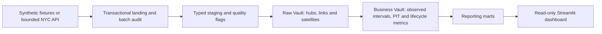

# NYC 311 Service Analytics — dbt + Data Vault 2.0

A reproducible portfolio project demonstrating Python ingestion, dbt transformations,
Data Vault 2.0 modeling, testing and local service analytics.

**The demonstration uses fictional synthetic snapshots and local DuckDB.**
It builds an insert-only Raw Vault, observed-time reporting marts and a read-only
Streamlit dashboard. This is a local analytics project; no production cloud
deployment is demonstrated.

[](https://github.com/oerbey/nyc-311-data-vault-dbt/actions/workflows/offline-ci.yml)
· [Verified successful run, October 28, 2026](https://github.com/oerbey/nyc-311-data-vault-dbt/actions/runs/40686163047)

## Technology stack

| Layer | Tools |
|---|---|
| Ingestion and validation | Python, httpx, Socrata API (optional live mode) |
| Local warehouse | DuckDB |
| Transformation and modeling | dbt Core, dbt-duckdb, Data Vault 2.0 |
| Dashboard | Streamlit, read-only reporting views |
| Quality and automation | pytest, dbt data tests, Ruff, GitHub Actions |

## Architecture



Raw Vault models retain observed changes, deterministic SHA-256 identities and
first-load provenance. Business Vault views derive observed status intervals,
bounded point-in-time (PIT) answers and reported lifecycle durations. Marts expose
request events, duration coverage, agency cohorts and observed status.

## Dashboard preview


*Local Streamlit dashboard with fictional synthetic data; these are not NYC totals.*
See the [portfolio overview](docs/PORTFOLIO.md) for the observed-status screenshot
and more reporting lineage.

## Reproduce the synthetic demo

Verified environment: **macOS ARM, Python 3.13.5**. Other platforms have not been
verified. Install Python 3.13 and `make`, then run:

```bash
git clone https://github.com/oerbey/nyc-311-data-vault-dbt.git
cd nyc-311-data-vault-dbt
python3.13 -m venv .venv
.venv/bin/python -m pip install -r requirements-lock.txt
.venv/bin/python -m pip check
make demo
make demo-dashboard
```

Open the local URL printed by Streamlit. The dashboard reads built reporting views;
it does not ingest records or run dbt. Close it before writing to the same database.

`make demo` loads three fixed fictional batches and runs the full dbt build with
`config/demo/profiles.yml`. The default database is `data/demo/nyc_open_data.db`.
Replay preserves stored observations, batch provenance and first-load timestamps.
`make demo-load` and `make demo-build` run the two steps separately.

To use a different isolated database, pass the same path to both commands:

```bash
make demo DEMO_DATABASE=/tmp/nyc311-demo/nyc_open_data.db
make demo-dashboard DEMO_DATABASE=/tmp/nyc311-demo/nyc_open_data.db
```

Cloning and dependency installation require network access. The synthetic demo
and checks need no live NYC API access, application token or other credentials.
The workflow does not provide operating-system network isolation.

## Testing and CI

Recorded verification on **October 28, 2026**:

| Check | Verified result |
|---|---|
| Ruff | Passed |
| Python suite | 393 tests passed; one IPython temporary-directory warning |
| Synthetic dbt build | 332 build nodes passed, including 296 dbt data tests |
| Full-build replay | Stored values and provenance unchanged |

Coverage includes timestamp parsing and DST uncertainty, adjacent status reversals,
agency reassignment, rejection of historical rewrites, idempotent replay and
dashboard calculations. The synthetic fixture includes Open → Closed → Open,
reassignment, unchanged observations and NULL fields.

Reproduce the checks from the repository root after installing dependencies:

```bash
make lint
make test
demo_dir="$(mktemp -d)"
make demo "DEMO_DATABASE=$demo_dir/nyc_open_data.db"
.venv/bin/python scripts/verify_synthetic_replay.py "$demo_dir/nyc_open_data.db"
```

The [offline CI workflow](.github/workflows/offline-ci.yml) runs on pushes, pull
requests and manual dispatch, using macOS 15 ARM and Python 3.13.5. It installs the
lockfile, runs lint and Python tests, and builds/replays the synthetic warehouse in
a temporary database. See the [roadmap](docs/IMPLEMENTATION_ROADMAP.md#m6--public-portfolio-quality)
for dated verification evidence and remaining release work.

For optional live ingestion, use the [bounded adapter instructions](docs/IMPLEMENTATION_GUIDE.md#live-nyc-311-landing-ingestion).
The default six-month cohort is configurable; run a count-only preflight before
extracting it. Live mode is separate from the synthetic quickstart above.

## Interpretation and limits

- **Observed history:** NYC 311 is a current-state feed. Status before the first
  observation is unknown; capture times do not establish source-change times.
- **Separate time questions:** creation/closure event trends and observed-as-of
  status answer different questions. A single extract cannot recover past status.
- **Duration coverage:** usable reported creation/closure timestamps supply closure
  durations, not an SLA or a causal measure of agency performance. Exclusions remain
  visible, and `due_date` describes an expected agency update.
- **Sample coverage:** synthetic data are fictional. Optional live ingestion verified
  one day (515 records); the six-month DEP/DSNY cohort has only been counted.
  Samples do not establish citywide completeness or transactional API snapshots.
- **Delivery status:** hosted dbt documentation and the complete keyboard/screen-reader
  dashboard review remain open. Chart marks are not keyboard-focusable; paged
  chart-data tables provide the same plotted values for further accessibility review.

## Documentation and example queries

- [Portfolio overview, screenshots and local dbt docs commands](docs/PORTFOLIO.md)
- [Detailed implementation guide and historical notes](docs/IMPLEMENTATION_GUIDE.md)
- [Project plan](docs/PROJECT_PLAN.md)
- [Data Vault architecture and model grains](docs/DATA_VAULT_ARCHITECTURE.md)
- [Reporting contracts, denominators and temporal semantics](docs/REPORTING_CONTRACTS.md)
- [Source-to-target dictionary](docs/SOURCE_DATA_DICTIONARY.md)
- [Implementation roadmap and verification evidence](docs/IMPLEMENTATION_ROADMAP.md)
- [Example SQL for the built synthetic warehouse](sql_queries/portfolio_examples.sql)
- [Agent instructions](AGENTS.md)

Source: [NYC Open Data, NYC311 service requests](https://data.cityofnewyork.us/d/erm2-nwe9).
The supplied source data dictionary informed field definitions; it is not committed.
Check current dataset metadata and terms before using live records.
