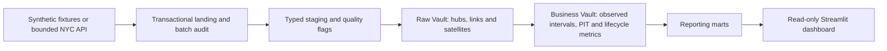
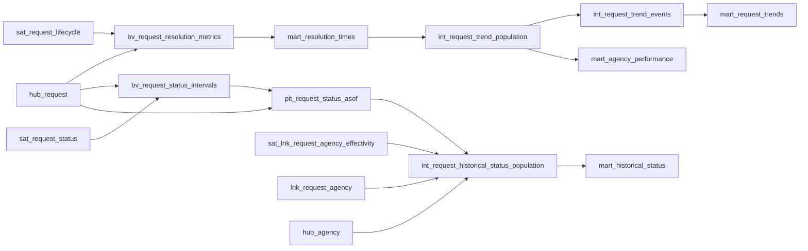
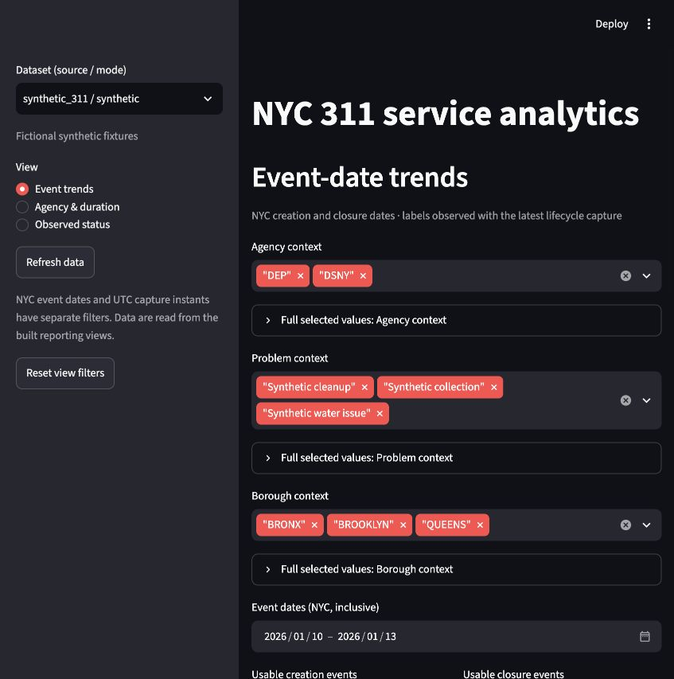
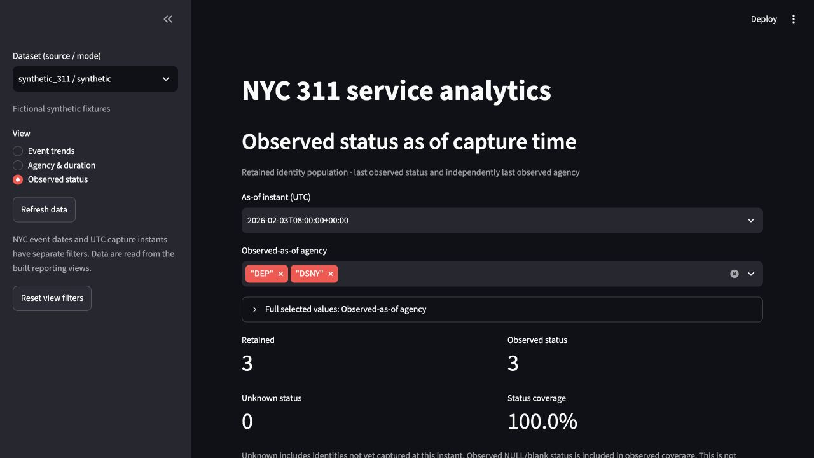

# Portfolio overview

This project builds an observed-history NYC 311 service analytics warehouse with Python, DuckDB, dbt Core and Data Vault 2.0. Its reproducible baseline uses fictional synthetic snapshots and needs no NYC API credentials.



The Raw Vault preserves capture observations and first-load provenance. The Business Vault derives status intervals and bounded as-of views; marts provide request events, lifecycle duration, agency cohorts and observed status. See [architecture decisions](DATA_VAULT_ARCHITECTURE.md) and [reporting contracts](REPORTING_CONTRACTS.md) for model grains and definitions.

The following diagram shows the principal reporting data paths. dbt's generated lineage includes the additional dependencies used for integrity preflight checks.







## Dashboard accessibility review

Chart marks are not keyboard-focusable. Each chart has a **Chart data** expander containing a paged text table with the same plotted values. Browser inspection confirmed scoped HTML column headers, and Enter opened representative expanders. A complete screen-reader review is still pending.

To complete that review with a screen reader, run `make demo-dashboard` and use the fictional dataset:

1. Using only the keyboard, select each view and expand each **Chart data** section. Check that focus is visible and the section's expanded state is announced.
2. Navigate each table with screen-reader table commands. Confirm the column headers and values are announced together and agree with the chart. Check the **Page** control and page count on a dataset with more than 25 chart rows.
3. At a narrow viewport, check full selected-value expanders, agency details, filters, tables and export controls. Confirm values are reachable without a mouse and labels are not clipped.
4. Record the screen reader, browser, viewport and results in the roadmap. Report any failures before marking the accessibility item complete.

## Limits

NYC 311 is a current-state feed, not a complete status change log. Status before the first observation is unknown, and snapshot captures do not establish source-change times. Event-date trends and snapshot-as-of status answer different questions. The synthetic demo is fictional and does not represent citywide coverage. Closure duration is based on usable reported creation and closure timestamps, not an SLA or causal measure of agency performance. The optional live extraction has verified a one-day cohort; the six-month cohort has only been counted. The API does not provide a transactional snapshot across pages.

Source: [NYC Open Data, 311 Service Requests](https://data.cityofnewyork.us/d/erm2-nwe9).

## Reproduce the synthetic demo

On the verified macOS ARM / Python 3.13.5 environment:

```bash
git clone https://github.com/oerbey/nyc-311-data-vault-dbt.git
cd nyc-311-data-vault-dbt
python3.13 -m venv .venv
.venv/bin/python -m pip install -r requirements-lock.txt
.venv/bin/python -m pip check
make lint
make test
make demo
.venv/bin/python scripts/verify_synthetic_replay.py data/demo/nyc_open_data.db
make demo-dashboard
```

Clone and installation require network access. The checks and demo use synthetic data without NYC API credentials. The dashboard opens the local URL printed by Streamlit.

[Example SQL](../sql_queries/portfolio_examples.sql) queries the built synthetic database for event trends, duration coverage, observed status and agency relationship history.

To generate and browse dbt's model documentation and lineage after `make demo`, run from the repository root:

```bash
export NYC311_DEMO_DATABASE="$PWD/data/demo/nyc_open_data.db"
.venv/bin/dbt docs generate --project-dir nyc_311_requests --profiles-dir config/demo
.venv/bin/dbt docs serve --project-dir nyc_311_requests --profiles-dir config/demo
```

Use the same absolute database path used by `make demo` if it was overridden. The generated catalog and manifest are local build artifacts and should not be committed.

**CV summary:** Built a reproducible NYC 311 analytics warehouse using Python, DuckDB, dbt and Data Vault 2.0, with observed status history, tested synthetic replay and a Streamlit dashboard.
